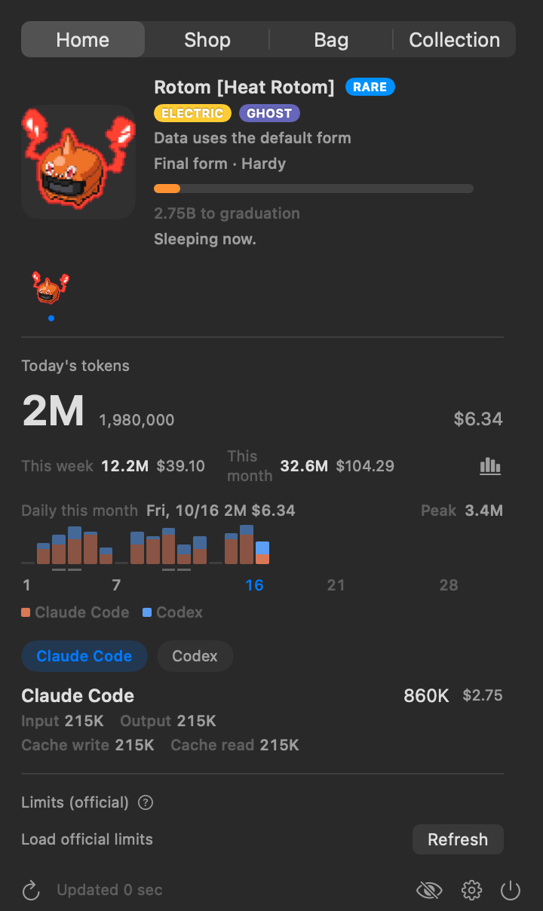
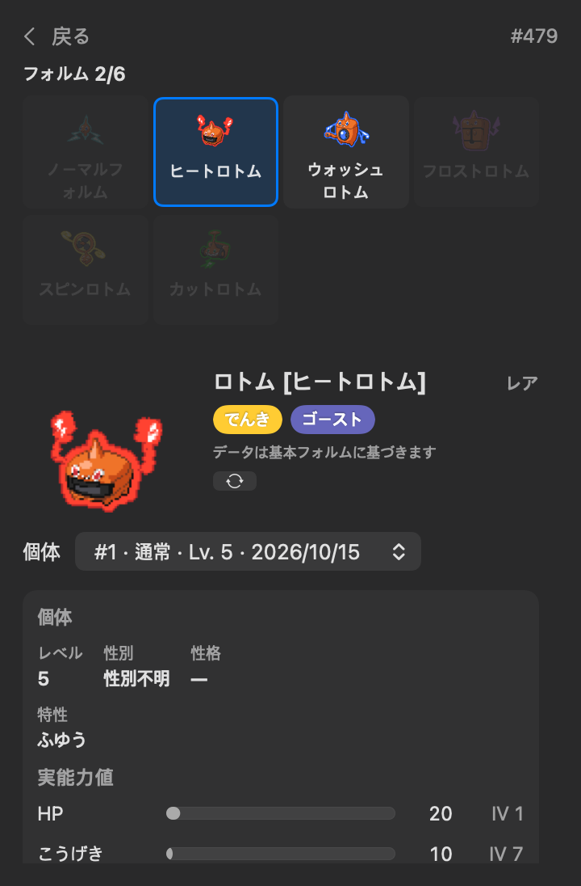
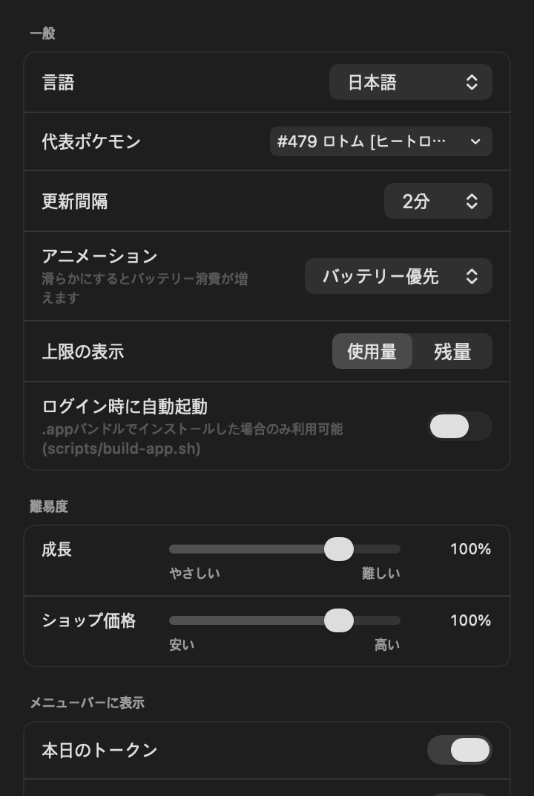
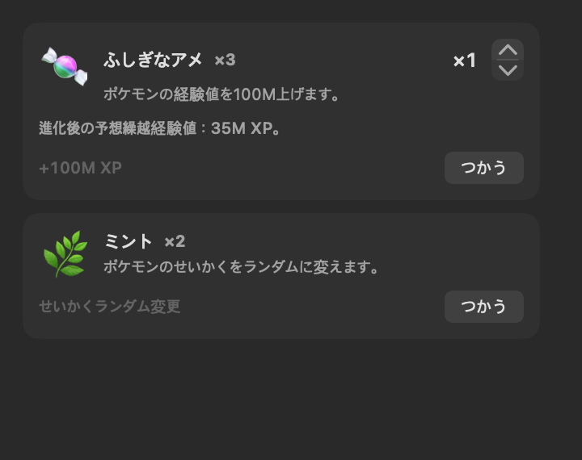
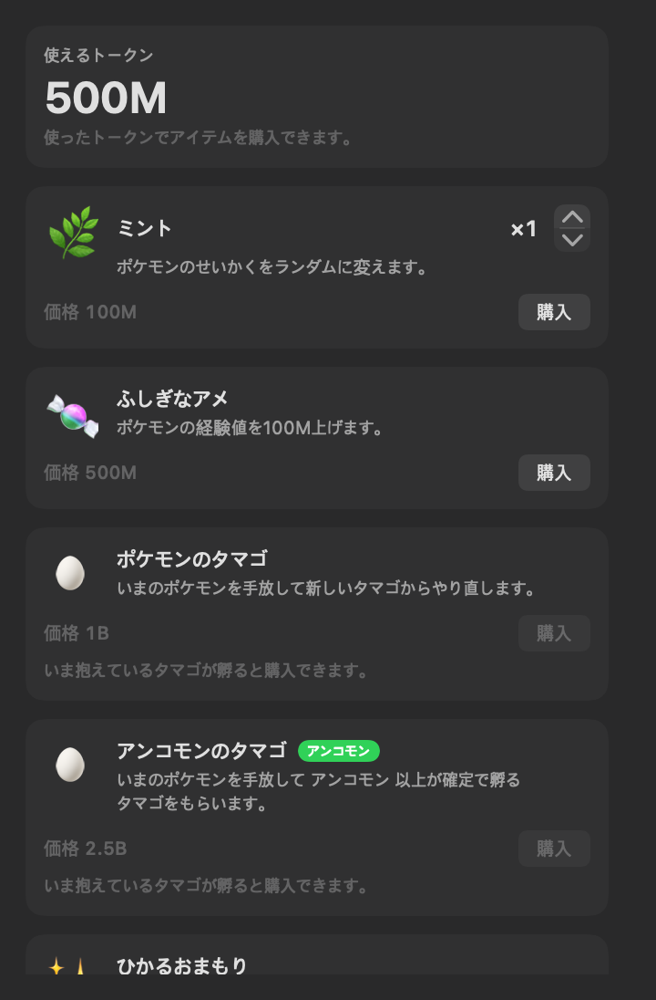
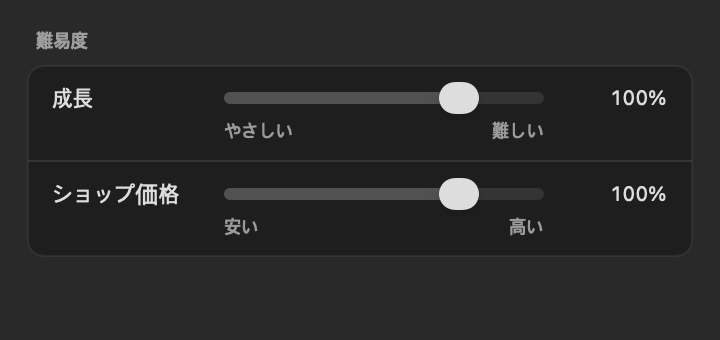
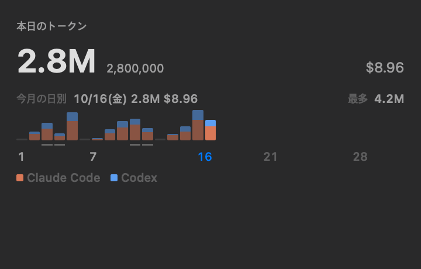
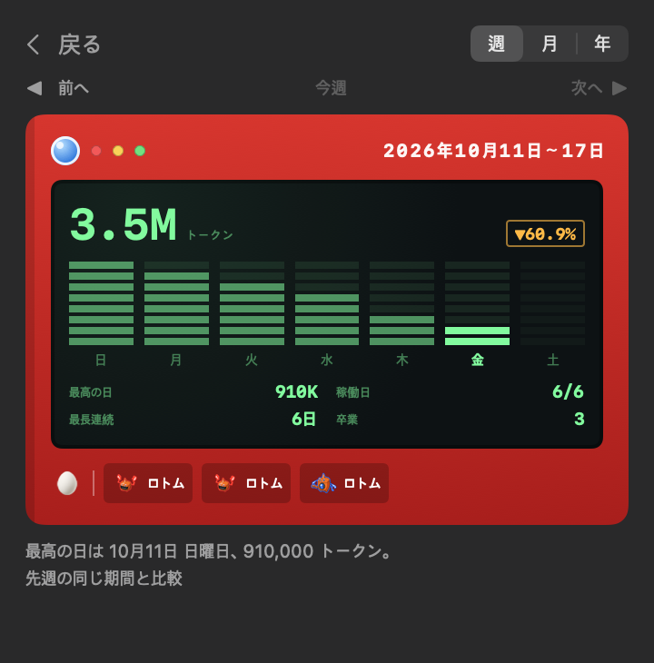

<div align="center">


# PokeTokenBar

**あなたのAIコーディングトークンを、ポケモンに — メニューバーで。**

[](https://github.com/chattymin/PokeTokenBar/releases)
[](https://www.apple.com/macos/)
[](https://swift.org)
[](#homebrew)
[](LICENSE)
[](https://github.com/sponsors/chattymin)

<a href="https://trendshift.io/repositories/84522?utm_source=repository-badge&amp;utm_medium=badge&amp;utm_campaign=badge-repository-84522" target="_blank" rel="noopener noreferrer"></a>
<a href="https://trendshift.io/repositories/84522?utm_source=trendshift-badge&amp;utm_medium=badge&amp;utm_campaign=badge-trendshift-84522" target="_blank" rel="noopener noreferrer"></a>


[English](README.md) · [한국어](README.ko.md) · **日本語**

</div>

PokeTokenBar は、あなたがすでに使っている AI コーディングトークン（Claude Code・Codex・Gemini CLI・Antigravity・OpenCode・Hermes Agent・Cursor・Grok CLI・Copilot CLI・Kiro CLI・Pi Agent・omp・Aside・Kimi Code）を、macOS メニューバーの中で育っていく **ポケモンのパートナー** に変えます。トークンを使うとタマゴが孵化し、実際の進化ラインに沿って進化し、最終進化後に図鑑へ卒業して、また新しいタマゴが始まります。パートナーの下には正確な使用量トラッカーがあります — 今日の使用量・コスト、公式の5時間／週間上限をローカルログから直接読み取ります。

> トークン使用量はローカルの Claude Code・Codex・Gemini CLI・Antigravity・OpenCode・Hermes Agent・Cursor・Grok CLI・Copilot CLI・Kiro CLI・Pi Agent・omp・Aside・Kimi Code データから直接読み取ります（`totalTokens` = input + output + cache、ローカル日付）— 外部 CLI 不要。非公式・非商用のポケモンファンプロジェクトです — [ライセンス & 免責](#ライセンス--免責) を参照。

## なぜ

- **開くのが楽しい使用量トラッカー。** 使用量がポケモンを育てます — 孵化し、進化し、卒業して図鑑を埋めます。色違い1匹が、また開く理由になります。
- 今日のトークン使用量とコストを一目で — ダッシュボードもブラウザタブも不要。
- 公式の **5時間 / 週間** 上限をリセットのカウントダウンとともに追跡し、現在の burn rate でいつ到達するかを予測します。

<div align="center">

</div>

## しくみ

1. 🥚 **いつも通りコーディング。** Claude Code・Codex・Gemini CLI・Antigravity・OpenCode・Hermes Agent・Cursor・Grok CLI・Copilot CLI・Kiro CLI・Pi Agent・omp・Aside・Kimi Code で使うトークンがタマゴを温めます — 追加の操作は不要です。
2. 🐣 **孵化。** [PokéAPI](https://pokeapi.co/) の**第1〜9世代すべての進化系統（起点541種）**から、公式の捕獲率で重み付けされて生まれます — よくいるポケモンは頻繁に、伝説は約220回に1回。孵化したポケモンは育成中もすぐに **図鑑** に表示されます。孵化ごとに25種類のせいかくがひとつ決まり — **ごくまれな偶然で ✨ 色違いが生まれます**。
3. ⚡ **進化。** コーディングを続けると実際の進化ツリー（1/2/3段階、分岐）に沿って育ち、各段階で小さな演出が流れます。
4. 🎓 **卒業 & 収集。** 最終進化 + 閾値で **図鑑** に永久保存されます — レアなほど時間がかかり（ヘビーユーザーで common ≈3日 → legendary ≈24日）— 新しいタマゴが届きます。
5. 🍬 **使うほどアメがもらえる。** 5時間・週間の使用量上限が埋まるにつれて **ふしぎなアメ** がもらえます。どのプランでも同じペースです。**バッグ** タブから使って、いまのポケモンを育てましょう。
6. 🛒 **ショップで使う。** これまで使ったトークンがそのまま通貨です — 新しい **ショップ** タブで **ふしぎなアメ**、せいかくをランダムに引き直す **ミント**、色違い確率を永続的に上げる **光るお守り**、いまのパートナーを手放してやり直すタマゴを購入できます。タマゴは3種類 — 通常の **ポケモンのタマゴ**、アンコモン以上が確定で孵る **アンコモンのタマゴ**、レア以上が確定で孵る **レアのタマゴ**。必要なポケモンを図鑑に登録すると、**しんかのいし**、**でんせつのどうぐ**、**ジムバッジ**を**実績**タブで無料で受け取れます。

## ツアー

<table>
<tr>
<td width="45%" align="center"></td>
<td width="55%" valign="middle">
<h3>🐾 デスクトップに置く</h3>
パートナーをメニューバーからデスクトップへ、48〜384px の好きなサイズで。ホバーで今日の使用量、クリックでポップオーバー、右クリックでメニュー、ドラッグで自由に移動 — 上限アラートはペットの上に吹き出しでも表示されます。
</td>
</tr>
<tr>
<td width="55%" valign="middle">
<h3>メニューバーの相棒</h3>
動くスプライトが今日のトークン合計（compact、例：<code>200.7M</code>）の隣に住んでいます。今日のコスト（<code>$</code>）や公式上限 <code>%</code> を追加しても、すべてオフにしてキャラクターだけにしても。
</td>
<td width="45%" align="center"></td>
</tr>
<tr>
<td width="45%" align="center"></td>
<td width="55%" valign="middle">
<h3>✨ ごくまれな偶然、色違い</h3>
色違いはメニューバー・ホームカード・進化ラインで専用カラーになり、進化しても維持されます。図鑑のマスでも所持している色違いの色と ✨ を表示し、詳細で所持している通常・色違いの姿を切り替えられます。アンノーンのマスは A のままで、文字と色は詳細で選びます。専用通知で孵化の瞬間をお知らせします。
</td>
</tr>
<tr>
<td width="55%" valign="middle">
<h3>埋めたくなる図鑑</h3>
<b>図鑑</b>は手に入れた種を1マスにまとめ、4×4配置で1ページ16マスを表示します。名前・番号での検索、レア度・色違いの絞り込み、並べ替えに対応。マウスホイール・トラックパッド、またはクリック範囲を広げた矢印でページを切り替えます。ホーム・進化ライン・<b>捕獲ログ</b>で収集済みのポケモンを押すと詳細へ移動し、戻ると元の図鑑ページやログの行を表示します。ログには個体ごとの進化ライン・レア度・せいかく・捕獲日が残ります。
</td>
<td width="45%" align="center"><br><br></td>
</tr>
<tr>
<td width="45%" align="center"><br><small>サンプルのポケモンで実際の UI をローカル描画した画像です。</small></td>
<td width="55%" valign="middle">
<h3>同じ種の別の姿も集める</h3>
ロトムの家電、シェイミのランド・スカイフォルム、シキジカの季節、アンノーンの文字、アローラ・ガラル・ヒスイ・パルデアのリージョンフォーム、ビビヨンの模様など、対応するすべてのフォルムを集められます。図鑑で収集数とフォルムごとの個体を確認し、所持フォルムをメニューバーとフローティングペットの代表に選びましょう。ひがしのうみのカラナクシは同じ姿のトリトドンへ進化し、保存・エクスポートでも姿を維持します。タイプ・能力値・特性・技はデフォルトの姿のデータを表示します。
</td>
</tr>
<tr>
<td width="45%" align="center"></td>
<td width="55%" valign="middle">
<h3>設定はお好みで</h3>
メニューバー表示項目、更新間隔（1–15分／手動）、ログイン時起動、上限セクションだけを隠す Keychain オフ、警告／危険の閾値とパートナーのイベント通知を設定できます。<b>韓国語／英語／日本語／スペイン語／フランス語／ポルトガル語／ドイツ語／ロシア語</b>の UI に対応。ポケモン・タイプ・特性・技の名前に翻訳がなければ英語を使います。
</td>
</tr>
<tr>
<td width="55%" valign="middle">
<h3>🍬 使うほど、ふしぎなアメ</h3>
使用量の上限は、使い切らなくても埋まるにつれて <b>ふしぎなアメ</b> をくれます。Proプランの5時間セッション1つで1個、1週間で5個、もっと大きなプランはPro何個分かに応じて(Max 20xのセッションは5%ごと、1週間は1%ごとに1個)。同じ使い方なら、どのプランでも同じペースでもらえます。<b>バッグ</b> タブから使っていまのポケモンを育てましょう。
</td>
<td width="45%" align="center"></td>
</tr>
<tr>
<td width="45%" align="center"></td>
<td width="55%" valign="middle">
<h3>🛒 使用量で回るショップ</h3>
これまで使ったトークンがそのまま通貨です。数量と合計価格を確認して消耗品をまとめ買いできます。<b>ふしぎなアメ</b>で育て、<b>ミント</b>でせいかくを引き直し、<b>光るお守り</b>で色違い確率を永続的に上げましょう。タマゴを買うと現在のパートナーを手放してやり直せます — 通常の<b>ポケモンのタマゴ</b>、アンコモン以上確定の<b>アンコモンのタマゴ</b>、レア以上確定の<b>レアのタマゴ</b>。等級付きのタマゴにも伝説は含まれます。空のバッグにはショップへのボタンがあります。
</td>
</tr>
<tr>
<td width="55%" valign="middle">
<h3>📊 公式の上限、Antigravity にも</h3>
Antigravity 2.0 と IDE が推定値ではなく実際のクォータを返します。Gemini モデル群と Claude &amp; GPT モデル群がそれぞれ <b>5時間</b>・<b>週間</b> のバケットとリセットのカウントダウンを持ち、Claude Code・Codex と並んで表示されます。バックグラウンドではトークンファイルを読み、OAuth 資格情報を自動更新できます。手動更新では Keychain にアクセスする場合があります。
</td>
<td width="45%" align="center"></td>
</tr>
<tr>
<td width="45%" align="center"></td>
<td width="55%" valign="middle">
<h3>📁 ログが既定の場所にないときは指定できます</h3>
ツールがセッションを既定のパスの外に置く場合は <b>設定 → 詳細</b> で独自のルートを追加してください — カンマ・改行区切り、<code>*</code> ワイルドカード、いま何個のフォルダが一致しているかをその場で表示します。プロバイダーごとにリストが分かれているので、あるツールのフォルダが別のツールのパーサーに渡ることはなく、追加したパスは既定のパスを置き換えるのではなく加算されます。
</td>
</tr>
<tr>
<td width="55%" valign="middle">
<h3>🔑 Keychain なしで公式上限</h3>
キャッシュされた上限トークンが切れると、公式の Claude 上限は更新を押すまで止まり、その更新が Keychain のパスワードプロンプトを出すことがありました。代わりに <b>設定 → 詳細</b> に <b>claude.ai セッションキー</b> を貼り付けてください — 上限を claude.ai から直接読むので Keychain には一切触れず、自動ポーリングが最新に保ち、保存した瞬間にキーを検証します。
</td>
<td width="45%" align="center"></td>
</tr>
<tr>
<td width="45%" align="center"></td>
<td width="55%" valign="middle">
<h3>🧮 一つのセッションログに複数のモデル</h3>
Pi は複数のモデルを一つのセッションログに流すことがあります。使用量は一律の「pi」ではなく<b>実際のモデル id</b> に帰属するようになり、一日に複数のモデルを使った場合はポップオーバーが本日のトークンをモデルごとに大きい順で表示します。
</td>
</tr>
<tr>
<td width="45%" align="center"></td>
<td width="55%" valign="middle">
<h3>一匹ごとに固有のプロフィール</h3>
<b>図鑑</b>で種を開くと、個体ごとのレベル・性別・せいかく・とくせい・個体値・計算された能力値・覚えた技を確認できます。種の説明ととくせい・技は選択言語を優先し、PokéAPIに翻訳がない場合は英語を使用します。
</td>
</tr>
<tr>
<td width="45%" align="center"></td>
<td width="55%" valign="middle">
<h3>みんな同じ成長ペース</h3>
成長の閾値とショップ価格は、すべてのプレイヤーで基本表の10分の1です。みんな最低にしていたスライダーはなくなり、別の値で作ったセーブも移るときに現在の段階の進捗を保ちます。卒業済みの進化系統から再び孵化すると<b>2倍の速さ</b>で育ちます。道具とバッジの成長ボーナスは足し算され(+25%と+25%で+50%)、ダブりのボーナスがその合計に掛かります。ホームの<b>ボーナス</b>画面で一つずつ確認できます。ホームの孵化・成長バーにポインタを重ねると使用量・目標と進捗率を表示します。
</td>
</tr>
<tr>
<td width="45%" align="center"></td>
<td width="55%" valign="middle">
<h3>今月の使用量を一日ずつ</h3>
今月のすべての日付を固定位置に置き、未来の日付は空欄にします。今月2つ以上のツールを使うと、日別のバーをツールごとの色で積み上げ、凡例を表示します。ポインタを重ねると、その日の合計とツール別トークン・コスト（コスト表示が有効な場合）を確認できます。今日の使用量が0でも週・月の履歴と合計、ふりかえりボタンは表示されます。
</td>
</tr>
<tr>
<td width="45%" align="center"></td>
<td width="55%" valign="middle">
<h3>一目でわかる上限</h3>
リセットのカウントダウンに実際の時刻を添え、すべての上限行の色付きパーセントを右端に揃えます。設定で使用量・残量を選ぶと、数値とグラフの両方が同じ基準に切り替わります。
</td>
</tr>
</table>

## コレクションアイテム

どのコレクションアイテムも、必要なポケモンを図鑑に登録するまで**ロック**されています。卒業させたポケモンと手放したポケモン、いま育てているポケモンがすでに到達した段階が登録として数えられます。解放されたアイテムはすべて**実績**タブで無料で受け取り、タブ名には受け取れる報酬の数が表示されます。実績タブのロック中のカードには必要なポケモンが表示され、未登録のポケモンはグレーで表示されます。受け取った後もカードに条件が小さく残ります。

### しんかのいし

石の実績を受け取ると、その石が**5個**、ほかの消耗品と一緒にバッグに入ります。1個使うといまのポケモンをすぐに手放し(図鑑には手放した記録として残ります)、石のタイプが確定で孵るタマゴを受け取ります。そのため、手放すポケモンがいるときだけ使えます。そのタイプでもう集め終えた系統は、石のタマゴでは4分の1の確率で出ます（ふつうのタマゴは半分）。どのタマゴも、直前に生まれた系統を続けて出しません。石の実績は1回だけ受け取れ、石はショップでは販売されません。

| 石 | スプライト | タマゴのタイプ | 解放条件 |
| :--- | :---: | :---: | :--- |
| **リーフのいし** |  | くさ | フシギバナ、リザードン、カメックス |
| **ほのおのいし** |  | ほのお | メガニウム、バクフーン、オーダイル |
| **みずのいし** |  | みず | ジュカイン、バシャーモ、ラグラージ |
| **かみなりのいし** |  | でんき | ドダイトス、ゴウカザル、エンペルト |
| **たいようのいし** |  | エスパー | ジャローダ、エンブオー、ダイケンキ |
| **つきのいし** |  | フェアリー | ブリガロン、マフォクシー、ゲッコウガ |
| **やみのいし** |  | あく | ジュナイパー、ガオガエン、アシレーヌ |
| **こおりのいし** |  | こおり | ゴリランダー、エースバーン、インテレオン |
| **めざめいし** |  | かくとう | マスカーニャ、ラウドボーン、ウェーニバル |
| **ひかりのいし** |  | ドラゴン | カイリュー、ボーマンダ、レックウザ |

最初の9つの石は世代の順番どおり: カントーからパルデアまで、石ごとにひとつの地方の最終進化の御三家を求めます。

### でんせつのどうぐ

**実績**タブで一度受け取れば、バッグにある間ずっと効果が続きます。

| どうぐ | スプライト | 解放条件 | 効果 |
| :--- | :---: | :--- | :--- |
| **てんかいのふえ** |  | 同じ伝説のポケモンを2回卒業 | 伝説のポケモンが2倍生まれやすくなる |
| **ぎんいろのはね** |  | フリーザー、サンダー、ファイヤー | タマゴの孵化に必要なトークンが半分になる |
| **ふるびたかいず** |  | ミュウツー、ミュウ | トークン消費による成長 +20% |
| **とうめいなスズ** |  | ライコウ、エンテイ、スイクン | レアのポケモンが25%早く育つ |
| **にじいろのはね** |  | ルギア、ホウオウ | ショップの全商品が25%引き |
| **かざんのおきいし** |  | レジロック、レジアイス、レジスチル **または** レジエレキ、レジドラゴ **または** 化石ポケモンのうち4匹¹ **または** ヒードラン | 卒業済みのラインの成長必要量が25%減 |
| **こころのしずく** |  | ラティアス、ラティオス | ふしぎなアメの経験値 +50% |
| **もえぎいろのたま** |  | カイオーガ、グラードン、レックウザ | タマゴがさらに20%引き |
| **グラシデアのはな** |  | ユクシー、エムリット、アグノム | 進化するポケモンが最初の段階で25%早く育つ |
| **はっきんだま** |  | ディアルガ、パルキア、ギラティナ | ゴースト・ドラゴンタイプのポケモンが30%早く育つ |
| **リバティチケット** |  | コバルオン、テラキオン、ビリジオン、ケルディオのうち3匹 | まだ卒業させていないラインの成長必要量が25%減 |
| **うつしかがみ** |  | トルネロス、ボルトロス、ランドロス、ラブトロスのうち3匹 | 色違い確率2倍(光るお守りと重複) |
| **いでんしのくさび** |  | レシラム、ゼクロム、キュレム | トークン消費による成長 +50% |
| **ジガルデキューブ** |  | ゼルネアス、イベルタル、ジガルデ | 図鑑25種ごとにトークン消費による成長 +1%（最大+40%） |
| **いましめのツボ** |  | ディアンシー、フーパ、ボルケニオン | 図鑑にない姿で生まれたポケモンが50%早く育つ |
| **かがやくいし** |  | カプ・コケコ、カプ・テテフ、カプ・ブルル、カプ・レヒレ | フェアリータイプのポケモンが30%早く育つ |
| **たいようのふえ** |  | ソルガレオ、ルナアーラ、ネクロズマ | 最終進化のポケモンが25%早く育つ |
| **ウルトラボール** |  | ウルトラビーストのうち4匹² | ウルトラビーストが50%早く育つ |
| **くちたけん** |  | ザシアン、ザマゼンタ、ムゲンダイナ | 伝説のポケモンが25%早く育つ |
| **キズナのタヅナ** |  | ブリザポス、レイスポス、バドレックス | ポケモンが卒業するたびにふしぎなアメ+1 |
| **ブーストエナジー** |  | パラドックスポケモンのうち4匹³ | パラドックスポケモンが50%早く育つ |
| **みどりのめん** |  | オーガポン、イイネイヌ、マシマシラ、キチキギス、モモワロウのうち4匹 | くさ・みず・ほのお・いわタイプのポケモンが20%早く育つ |
| **テラスタルオーブ** |  | コライドン、ミライドン、テラパゴス | 進化の石のタマゴが2倍早くかえる |
| **こだいのせきぞう** |  | レジロック、レジアイス、レジスチル、レジギガス、レジエレキ、レジドラゴ | 進化しないポケモンが25%早く育つ |
| **みかづきのはね** |  | クレセリア、ダークライ | エスパー・あくタイプのポケモンが30%早く育つ |
| **いんせき** |  | ジラーチ、デオキシス | トークン上限を使い切るたびにふしぎなアメが1個多くもらえる |
| **オーキドのてがみ** |  | セレビィ、シェイミ | すべての地方の御三家がどの段階でも25%早く育つ |
| **うしおのおこう** |  | マナフィ(フィオネが進化する) | レア度確定のタマゴ(ショップ、レジェンドプレート)が2倍早くかえる |
| **イナズマカセット** |  | ビクティニ、メロエッタ、ゲノセクト | 化石ポケモン¹がどの段階でも50%早く育つ |
| **Ｚリング** |  | シルヴァディ、マギアナ、マーシャドー、ゼラオラ、メルメタルのうち4匹 | はがね・でんきタイプのポケモンが30%早く育つ |
| **あくのかけじく** |  | ウーラオス、ザルード | かくとうタイプのポケモンが30%早く育つ |
| **こだいのツボ** |  | チオンジェン、パオジアン、ディンルー、イーユイ | 中間の進化段階のポケモンが25%早く育つ |
| **レジェンドプレート** |  | アルセウス | レアのタマゴとアンコモンのタマゴが1個ずつバッグに:ショップと同じく、ポケモンを手放してそのレア度以上のタマゴをもらう |
| **でんきだま** |  | ピカチュウのいしょう15着すべて | レアのタマゴ2個とふしぎなアメ5個がバッグに |
| **タイプ：ヌルのタマゴ** |  | シルヴァディのメモリ17個すべて⁴ | いまのポケモンを手放して、タイプ：ヌルが生まれるタマゴを受け取る |
| **まるいおまもり** |  | すべての種 (1,025) | 残っているあいだ、まだ集めていないフォルムがあるポケモンだけがそのフォルムで生まれる |
| **きらめくおまもり** |  | すべてのフォルム (1,350) | 生まれるポケモンがすべて色違いになる |

生まれるポケモンの確率を変えるのはてんかいのふえとまるいおまもりだけで、まるいおまもりはすべての種を集めてから手に入ります。ほかのどうぐはすべて純粋なボーナスで、ほかのポケモンの確率を下げません。

¹ オムスター、カブトプス、プテラ、ユレイドル、アーマルド、ラムパルド、トリデプス、アバゴーラ、アーケオス、ガチゴラス、アマルルガ、パッチラゴン、パッチルドン、ウオノラゴン、ウオチルドン。
² ウツロイド、マッシブーン、フェローチェ、デンジュモク、テッカグヤ、カミツルギ、アクジキング、ベベノム、アーゴヨン、ツンデツンデ、ズガドーン。
³ イダイナキバ、サケブシッポ、アラブルタケ、ハバタクカミ、チヲハウハネ、スナノケガワ、テツノワダチ、テツノツツミ、テツノカイナ、テツノコウベ、テツノドクガ、テツノイバラ、トドロクツキ、テツノブジン、ウネルミナモ、テツノイサハ、ウガツホムラ、タケルライコ、テツノイワオ、テツノカシラ。
⁴ シルヴァディはタイプ：ヌルとして生まれ、ノーマルフォルムで進化します。図鑑にいる伝説・幻のポケモン(手放した個体も含む)ごとに、そのフォルムのタイプのメモリが手に入ります(ファイヤー：ほのお・ひこう、ガラルのすがたのファイヤー：あく・ひこう)。むしタイプの伝説はゲノセクトだけです。シルヴァディが図鑑にいれば、メモリごとにそのフォルムが解放され(図鑑のフォルム一覧に表示)、17個すべてそろうとタイプ：ヌルのタマゴを受け取れます。

**フォルム**(実績の新しいタブ):1種のすべてのフォルムを卒業させるともらえます。

| 実績 | どうぐ | 条件 | ごほうび |
|---|---|---|---|
| **ロトムのカタログ** |  | ロトムの6フォルム | 持っていると、その進化ラインになかったフォルムで生まれたポケモンごとにふしぎなアメ1個 |
| **すいせいのかけら** |  | メテノの7つのコア | ふしぎなアメ5個 |
| **くれないのミツ** |  | オドリドリの4スタイル | ふしぎなアメ3個 |
| **さらさらいわ** |  | ポワルンの4フォルム | ふしぎなアメ3個 |
| **メブキジカの四季** |  | メブキジカの4つの季節 | アンコモンのタマゴ1個 |
| **ようせいのハネ** |  | フラージェスの5色 | アンコモンのタマゴ1個 |
| **トリミアンの10のカット** |  | トリミアンの10のカット | レアのタマゴ1個 |
| **ビビヨンの20のもよう** |  | ビビヨンの20のもよう | レアのタマゴ2個 |
| **ホイップポップ** |  | マホイップの63フォルム | レアのタマゴ2個とふしぎなアメ5個 |
| **アンノーンのアルファベット** |  | アンノーンの28文字 | レアのタマゴ2個 |

### ジムバッジ

すべてのバッジには**世代ごとに1つの地方**があります。その地方のそのタイプのポケモンをすべて図鑑に登録すると完成し、**実績**タブで受け取れます(バッジのカードごとに9つの地方が受け取り済み・受け取り可能・進行中で表示されます)。受け取った地方ごとに、そのタイプに弱いポケモンが2.5%早く育つので、9つの地方すべてで22.5%です。カントーにはあくタイプのポケモンがいないため、あくのバッジは8つの地方(20%)です。複数のバッジに弱いポケモンには効果が重なります。地方ができる前に受け取ったバッジはカントー(あくはジョウト)の地方として数えられます。 バッジはアルセウスにそのタイプのプレートも与えます。アルセウスはノーマルフォルムで生まれ、図鑑に登録されると、地方を1つでも受け取ったバッジごとにそのタイプのフォルムが解放されます(クリムゾンバッジでほのおのアルセウス)。図鑑のフォルム一覧で、フォルムごとに必要なバッジを表示します。

| バッジ | スプライト | タイプ | 地方ごとのポケモン | 効果を受けるポケモン |
| :--- | :---: | :---: | :--- | :--- |
| **グレーバッジ** |  | いわ | カントー 11 · ジョウト 7 · ホウエン 12 · シンオウ 7 · イッシュ 10 · カロス 8 · アローラ 5 · ガラル 6 · パルデア 8 | ほのお、こおり、ひこう、むし |
| **ブルーバッジ** |  | みず | カントー 32 · ジョウト 18 · ホウエン 28 · シンオウ 14 · イッシュ 17 · カロス 9 · アローラ 13 · ガラル 11 · パルデア 12 | ほのお、じめん、いわ |
| **オレンジバッジ** |  | でんき | カントー 9 · ジョウト 8 · ホウエン 4 · シンオウ 7 · イッシュ 11 · カロス 3 · アローラ 6 · ガラル 9 · パルデア 12 | みず、ひこう |
| **レインボーバッジ** |  | くさ | カントー 14 · ジョウト 10 · ホウエン 17 · シンオウ 14 · イッシュ 20 · カロス 9 · アローラ 13 · ガラル 10 · パルデア 20 | みず、じめん、いわ |
| **ピンクバッジ** |  | どく | カントー 33 · ジョウト 4 · ホウエン 5 · シンオウ 8 · イッシュ 7 · カロス 2 · アローラ 7 · ガラル 5 · パルデア 12 | くさ、フェアリー |
| **ゴールドバッジ** |  | エスパー | カントー 14 · ジョウト 10 · ホウエン 20 · シンオウ 9 · イッシュ 15 · カロス 6 · アローラ 8 · ガラル 9 · パルデア 11 | かくとう、どく |
| **クリムゾンバッジ** |  | ほのお | カントー 12 · ジョウト 10 · ホウエン 6 · シンオウ 5 · イッシュ 15 · カロス 8 · アローラ 8 · ガラル 7 · パルデア 10 | くさ、こおり、むし、はがね |
| **グリーンバッジ** |  | じめん | カントー 14 · ジョウト 10 · ホウエン 13 · シンオウ 10 · イッシュ 11 · カロス 2 · アローラ 4 · ガラル 4 · パルデア 7 | ほのお、でんき、どく、いわ、はがね |
| **ウイングバッジ** |  | ひこう | カントー 19 · ジョウト 19 · ホウエン 12 · シンオウ 14 · イッシュ 18 · カロス 8 · アローラ 8 · ガラル 5 · パルデア 6 | くさ、かくとう、むし |
| **インセクトバッジ** |  | むし | カントー 12 · ジョウト 10 · ホウエン 14 · シンオウ 9 · イッシュ 18 · カロス 3 · アローラ 11 · ガラル 8 · パルデア 7 | くさ、エスパー、あく |
| **レギュラーバッジ** |  | ノーマル | カントー 22 · ジョウト 15 · ホウエン 18 · シンオウ 17 · イッシュ 17 · カロス 8 · アローラ 12 · ガラル 8 · パルデア 14 | ノーマルタイプ(ノーマルに弱いタイプがないため) |
| **ファントムバッジ** |  | ゴースト | カントー 3 · ジョウト 1 · ホウエン 6 · シンオウ 8 · イッシュ 9 · カロス 8 · アローラ 8 · ガラル 9 · パルデア 13 | エスパー、ゴースト |
| **ショックバッジ** |  | かくとう | カントー 8 · ジョウト 3 · ホウエン 7 · シンオウ 7 · イッシュ 15 · カロス 4 · アローラ 10 · ガラル 8 · パルデア 11 | ノーマル、こおり、いわ、あく、はがね |
| **スチールバッジ** |  | はがね | カントー 2 · ジョウト 4 · ホウエン 9 · シンオウ 10 · イッシュ 12 · カロス 4 · アローラ 8 · ガラル 5 · パルデア 11 | こおり、いわ、フェアリー |
| **アイスバッジ** |  | こおり | カントー 5 · ジョウト 5 · ホウエン 6 · シンオウ 6 · イッシュ 7 · カロス 4 · アローラ 1 · ガラル 7 · パルデア 7 | くさ、じめん、ひこう、ドラゴン |
| **ライジングバッジ** |  | ドラゴン | カントー 3 · ジョウト 1 · ホウエン 9 · シンオウ 6 · イッシュ 10 · カロス 9 · アローラ 7 · ガラル 11 · パルデア 14 | ドラゴン |
| **あくバッジ** |  | あく | ジョウト 6 · ホウエン 10 · シンオウ 7 · イッシュ 16 · カロス 5 · アローラ 2 · ガラル 10 · パルデア 13 | エスパー、ゴースト |
| **フェアリーバッジ** |  | フェアリー | カントー 5 · ジョウト 8 · ホウエン 5 · シンオウ 2 · イッシュ 2 · カロス 13 · アローラ 12 · ガラル 8 · パルデア 9 | かくとう、ドラゴン、あく |

## そのほかにも

- **メニューバーのショートカット** — 右クリック・Control クリックで今日の概要、更新、図鑑、設定、フローティングペットの表示切替、終了メニューを開きます。
- **低電力モード** — メニューバーのアニメーションはバッテリー優先の品質で継続します。
- **再接続時の更新** — ネットワークが復帰すると使用量と上限を更新します。
- **代表ポケモン** — 図鑑で所有している種を選び、育成中のポケモンとは別にメニューバーと任意のフローティングペットへ固定。固定中はメニューバーがタマゴ・孵化・進化を追わなくなりますが、育成の進行は Home で引き続き確認できます。
- **アニメーション品質** — メニューバーのスプライトとフローティングペットの滑らかさを選べます（バッテリー優先／標準／滑らか）。常に表示される2つの表面が同じ設定を共有します。既定の「バッテリー優先」はこの設定が入る前と同じフレームレートで、「標準」「滑らか」はバッテリーを多く使います（実測アイドル CPU 約1.8%／約5.1%）。
- **インタラクティブなフローティングペット** — ホバーで今日の使用量、クリックでメイン画面、右クリックでメニュー、上限アラートは吹き出しで表示。
- **サービス別タブ** — Claude Code・Codex・Gemini CLI・Antigravity・OpenCode・Hermes Agent・Cursor・Grok CLI・Copilot CLI・Kiro CLI・Pi Agent・omp・Aside・Kimi Code のうち2つ以上が検出されると、小さなタブでサービス別の詳細を切替（今日の合計は合算のまま）。
- **公式の上限** — Claude・Codex・Antigravity の5時間／週間使用率とリセットのカウントダウンを、今日の数字のすぐ下に。
- **追加スキャンフォルダ** — 既定のパスの外にあるログのために、プロバイダーごとにスキャンルートを追加（設定 → 詳細）。
- **複数の Claude アカウント** — 設定フォルダ（`CLAUDE_CONFIG_DIR`）ごとにログインした Claude Code アカウントには公式上限の下にそれぞれのタブが付き、ゲージ・ふしぎなアメ・通知・今日/今月のトークンを個別に表示します。`~/.claude-*` フォルダとエクスポートされた `CLAUDE_CONFIG_DIR` は自動で見つけ、それ以外の場所は設定 → 詳細で追加します。メニューバーの上限 %・コンパニオンの様子・予測は最後に使ったアカウントに従います（設定 → 一般 → 追跡する Claude アカウント）。アカウントごとに claude.ai セッションキーを設定でき（設定 → 詳細）、Keychain なしでもそのアカウントの上限が更新され続けます。
- **消費予測** — 現在の5時間ウィンドウが100%に達する時刻を予測。
- **アプリ内アップデート** — ワンクリックの更新確認、設定に現在のバージョンを表示。
- **使用量のふりかえり** — 週・月・年ごとの図鑑風まとめ（合計・ゲージ・前の期間との比較・最高の日・最長連続・卒業）。ゲージにポインタを重ねると日付と省略しないトークン数を表示し、今週／今月／今年ボタンで現在の期間に戻れます。記録は今年と昨年分をローカルに保存します。
- **統計ページ**: ホームのグラフボタンですべての数字をまとめて見られます。今月の日ごとのグラフ、上の使用量のふりかえりと日ごとの表(トークン、卒業したポケモン)、コレクションの数字。

- **ローカルセーブのバックアップ** — 自動スナップショットと破損時の復旧に対応し、設定から以前の保存状態を復元できます。バックアップ履歴は折りたたんだ状態で開き、展開して確認できます。**スナップショットを作成**は一覧の外からすぐに使えます。
- **ポケモンのフォルム** — リージョンフォームを含む全世代の別フォルムを集め、フォルムごとの個体を確認し、所持フォルムをメニューバーとフローティングペットの代表に選べます。姿は進化・保存・エクスポートでも維持され、以前のアンノーンの文字データも読み込めます。[フォルム一覧](docs/reference/pokemon-forms.md)をご覧ください。
- **全国図鑑**: TokenDexのように全種を地方ごとに表示します。完成率と色違い、地方ごとの進み具合とレア度、入手した種はレア度の色で、見ただけの種は薄く、いない種は番号で。すべて・入手済み(ページごとの格子)・未入手を切り替えられます。
- **ふしぎなアメの一括使用** — 複数のアメをまとめて使い、使用前に成長結果を確認できます。
- **メニューバーのポケモン**: メニューバーのポケモンを、動かす・止める（1フレームで再描画なし）・隠して使用量の文字だけにする、から選べます（設定 → 一般）。文字の行をすべてオフにすると、隠したポケモンは止まった姿で戻り、いつでもクリックできます。
- **新しいフォルムのバッジ**: その系統にないフォルムで生まれたポケモンは、育っているあいだホームに、卒業後は捕獲記録に表示されます。
- **ピカチュウのいしょう**: ピカチュウが来るたびに、まだない衣装か帽子をひとつ持ってきて、育つあいだ着ています。図鑑のピカチュウのページで、ほかのピカチュウが着る衣装を選べます。15着そろうとでんきだまがもらえます。
- **誕生日のプレゼント**: 設定に誕生日を入れると、その日から3か月以内にアプリを開いたとき、バナーがプレゼントのタマゴを渡します。年に1回。なにが生まれるかはお楽しみ。
- **イベントのタマゴ**: クリスマス、お正月、バレンタイン、ポケモンデー、イースター、ハロウィン、季節の始まり、そして最初の捕獲の記念日に、その日のために描いたタマゴが届きます。イベント中とその後2週間、バナーが渡します。年に1回。生まれるのはイベントのポケモンで、色違いのことが多いです。
- **最新情報**: 新聞ボタンですべての変更をアップデートごとに新機能・改善・修正に分けて確認でき、更新後は前回から変わったことをバナーでお知らせします。
- **アイデア**: 電球ボタンでアイデアやバグをこのリポジトリのissueとして送れます。GitHub CLI(`gh`)でログインしていればアプリが直接投稿し、そうでなければ入力済みでブラウザに開きます。アプリはトークンを持ちません。
- **上限の使用ペース** — ゲージの経過時間マーカーと6段階の色で使用ペースを確認できます。メニューバーの上限割合にも同じ色を使用します。



<small>上のホーム・設定・フォルム・ショップ・バッグ・難易度・日別グラフ・振り返り画像は、サンプルデータで実際の UI をローカル描画したものです。</small>

## 対応ツール

| ツール | 集計範囲 | 公式の上限 |
|---|---|---|
| **Claude Code** | 今日 · 5時間ブロック · 週 · 月 | ✅ 5時間／週間 |
| **Codex** | 今日 · 週 · 月 | ✅ 5時間／週間 |
| **Gemini CLI** | 今日 · 週 · 月 | — |
| **Antigravity** | 今日 · 5時間ブロック · 週 · 月 | ✅ 5時間／週間 |
| **OpenCode** | 今日 · 5時間ブロック · 週 · 月 | — |
| **Hermes Agent** | 今日 · 5時間ブロック · 週 · 月 | — |
| **Cursor** | 今日 · 5時間ブロック · 週 · 月 | — |
| **Grok Build CLI** | 今日 · 5時間ブロック · 週 · 月 | — |
| **Copilot CLI** | 今日 · 5時間ブロック · 週 · 月 | — |
| **Kiro CLI** | 今日 · 5時間ブロック · 週 · 月 | — (推定値) |
| **Pi Agent** | 今日 · 5時間ブロック · 週 · 月 | — |
| **omp** (oh-my-pi) | 今日 · 5時間ブロック · 週 · 月 | — |
| **Aside** | 今日 · 5時間ブロック · 週 · 月 | — |
| **Kimi Code** | 今日 · 5時間ブロック · 週 · 月 | — |

Grok の対応範囲は Grok Build CLI のローカルセッションログです。Grok Bot のクラウド使用量とサブスクリプションの上限は連携していません。

すべてローカルから読み取り — 外部の使用量CLIは不要。ツールはプロバイダーの実装と登録で追加します（[CONTRIBUTING.ja.md](CONTRIBUTING.ja.md) 参照）。

## インストール

### 必要条件

macOS 14+（Apple Silicon または Intel）。それだけ — トークン使用量はローカルの Claude Code・Codex・Gemini CLI・Antigravity・OpenCode・Hermes Agent・Cursor・Grok CLI・Copilot CLI・Kiro CLI・Pi Agent・omp・Aside・Kimi Code データから直接読み取り、外部の使用量 CLI は不要です。

### Homebrew

```bash
brew install --cask chattymin/tap/poke-token-bar
```

ad-hoc／自己署名アプリのため、Cask インストール時に隔離属性を自動で除去します。

### 手動インストール（Homebrew なし）

Homebrew を使わない場合は、[最新リリース](https://github.com/chattymin/PokeTokenBar/releases/latest) から `PokeTokenBar.zip` をダウンロードして展開し、`PokeTokenBar.app` を `/Applications` にドラッグします。

このアプリは ad-hoc／自己署名（Apple Developer アカウントでの公証なし）のため、初回起動時に Gatekeeper が「開発元が未確認」の警告を表示します。次のいずれかで一度だけ解除してください。

- **Finder:** `PokeTokenBar.app` を右クリック（または Control+クリック）→ **開く** → ダイアログで再度 **開く**。
- **ターミナル:** `xattr -dr com.apple.quarantine /Applications/PokeTokenBar.app`

（Homebrew Cask は隔離属性を自動で除去するため、この手順は不要です。）

### ソースからビルド

```bash
swift build                  # デバッグ
swift test                   # ユニットテスト
./scripts/build-app.sh       # release → PokeTokenBar.app → /Applications
```

## データソース

| ソース | 用途 | 備考 |
|---|---|---|
| `~/.claude/projects/**/*.jsonl`、`<設定フォルダ>/projects/**/*.jsonl` | Claude Code daily/blocks/weekly/monthly | 直接読み取り；メッセージ id で重複排除；増分キャッシュ |
| `~/.claude.json`、`~/.claude-*/.claude.json` | Claude アカウント：ログイン中の設定フォルダとアカウント名 | `oauthAccount` ブロックのみ使用；エクスポートされた `CLAUDE_CONFIG_DIR` と設定 → 詳細のフォルダも対象 |
| `~/.claude/history.jsonl`、`<設定フォルダ>/history.jsonl` | アカウントごとの Claude トークン；最後に使ったアカウント | セッション id とプロンプト時刻のみ読み取り、プロンプト本文は読みません；追加された行だけを読み取り |
| `~/.gemini/tmp/**/chats/*.json(l)` | Gemini CLI daily/monthly | セッションレコード（メッセージ別 `tokens`）；週間 = daily 合算 |
| `~/.gemini/antigravity/conversations/*.db`<br>`~/.gemini/antigravity-cli/conversations/*.db`<br>`~/.gemini/antigravity-ide/conversations/*.db` | Antigravity daily/blocks/weekly/monthly | SQLite 読み取り専用；Cascade protobuf blob の呼び出し単位の使用量；Antigravity 2.0/Core, CLI, IDE をサポート；Gemini には合算しない独立プロバイダ；サブスクのためコストは推定しない |
| `~/.codex/sessions/**/*.jsonl` | Codex daily/monthly | `token_count` イベント；週間 = daily 合算 |
| `~/.local/share/opencode/opencode.db` | OpenCode daily/blocks/weekly/monthly | SQLite 読み取り専用；レガシー `storage/message` JSON にも対応 |
| `~/.hermes/state.db` | Hermes Agent daily/blocks/weekly/monthly | SQLite 読み取り専用；セッショントークン合計と保存済みコスト |
| `~/Library/Application Support/Cursor/User/globalStorage/state.vscdb` | Cursor daily/blocks/weekly/monthly | SQLite 読み取り専用のフォールバック（`cursorDiskKV` バブルエントリの `tokenCount`）；サインイン時は `cursor.com` ダッシュボード API が主ソース（プライバシー参照） |
| `cursor.com`（ダッシュボード API） | Cursor daily/blocks/weekly/monthly | 非公式 JSON endpoint（`get-filtered-usage-events`）；セッションは `state.vscdb` の `cursorAuth/accessToken` または `CURSOR_SESSION_TOKEN`；プロバイダー更新のたびに再取得；ネットワーク失敗時はアカウント単位に分離された最大6時間以内のディスクキャッシュで代替；`CURSOR_USAGE_API=0` で無効化 |
| `api2.cursor.sh`（ダッシュボード上限 API） | Cursor 公式の月間 included usage | Connect RPC `GetCurrentPeriodUsage`；`state.vscdb` または `CURSOR_SESSION_TOKEN` の Bearer JWT；usage events と同じ無効化スイッチ |
| `~/.grok/sessions/**/updates.jsonl` | Grok Build CLI daily/blocks/weekly/monthly | `turn_completed` レコード（ターン単位の `usage`、サーバー報告のコスト）；`$GROK_HOME` を設定していればそのパス；サブエージェントのセッションは親ターンに合算済みのため除外 |
| `~/.copilot/session-store.db` | Copilot CLI daily/blocks/weekly/monthly | SQLite 読み取り専用；`assistant_usage_events` の1行が API 呼び出し1回；`$COPILOT_HOME` を設定していればそのパス；`input_tokens` にキャッシュ分が含まれるため cache read/write を差し引いて集計；premium request 課金のためコストは推定しない |
| `~/Library/Application Support/kiro-cli/data.sqlite3`<br>`~/.kiro/sessions/cli/*.jsonl`<br>`~/.kiro/sessions/<ws>/<session>/messages.jsonl` | Kiro CLI daily/blocks/weekly/monthly | 2.20 以前の SQLite と 2.20+ / `--v3` の JSONL。どちらも実トークン数を記録しないため、input は毎ターン再送される累積会話テキストをバイト÷4 で**推定**。`usage_summary` のクレジットは USD に換算しない。`/clear`・圧縮で消えた SQLite 会話の集計済みトークンはアプリ再起動まで数え続ける。`$KIRO_CLI_HOME` と `$KIRO_HOME` に対応 |
| `~/.pi/agent/sessions/**/*.jsonl` | Pi Agent daily/blocks/weekly/monthly | 全プロジェクトの保存済み usage を直接集計；`$PI_CODING_AGENT_DIR`・`$PI_CODING_AGENT_SESSION_DIR` override 対応；output には reasoning がすでに含まれるため二重計上しない；fork のコピーは entry ID で重複排除；記録されたコストを使用 |
| `~/.omp/agent/sessions/**/*.jsonl` | omp (oh-my-pi) daily/blocks/weekly/monthly | pi 形式セッション JSONL；すべての assistant `usage` イベントを合算（巻き戻した分岐も請求済みトークン）し、サブエージェントのセッションファイルも親に折り込まれないため合算対象；`$OMP_CODING_AGENT_DIR` を尊重；イベントごとの `cost` が記録されていればそのまま信頼；`bridge/` 以下の変換コピーは原本側で集計済みのため除外 |
| `~/.aside/u/*/state.db` | Aside daily/blocks/weekly/monthly | SQLite のターン合計を読み取り専用で集計；削除済みターンはスキャンキャッシュのリセットまで集計を保持；記録されたコストのみ使用 |
| `~/.kimi-code/sessions/**/agents/*/wire.jsonl` | Kimi Code daily/blocks/weekly/monthly | すべての `usage.record`（リクエスト単位、`turn`・`session` スコープ）をメイン・サブエージェントの wire ファイル全体で合算；`$KIMI_CODE_HOME` と Kimi デスクトップのランタイムルートを尊重；`/fork` のコピーはレコード内容で重複除去；Kimi はコストを記録しないためコストは「なし」と表示 |
| Keychain（`Claude Code-credentials`、ほかの設定フォルダごとに `Claude Code-credentials-<hash>`）/ `<設定フォルダ>/.credentials.json` → `api.anthropic.com` | アカウントごとの Claude 公式 5h/週間 % | 非公式 endpoint；Keychain は**更新ボタンを押した時のみ**読み取り — 自動更新では読みません |
| `codex app-server` | Codex 公式 5h/週間 % | ローカル子プロセス；アカウント snapshot のみ、モデル turn なし |
| [PokéAPI](https://pokeapi.co/) — `pokeapi.co`, `graphql.pokeapi.co` | ポケモンの種・能力値・特性・技・進化 | ランタイム取得；ローカルキャッシュ、バンドルしない |
| `raw.githubusercontent.com/PokeAPI/sprites` | ポケモン・アイテムのスプライト | ランタイム取得；Application Support にキャッシュ、バンドルしない |
| `status.claude.com`, `status.openai.com` | プロバイダ障害バナー | statuspage の要約；表示専用 — 設定でオフにできます |
| `api.github.com` | アップデート確認 | 最新リリースのタグ；起動時とポップオーバーを開いた時 |

ログが**上記の既定パスの外**にある場合は、**設定 → 詳細 → 追加スキャンフォルダ**にそのフォルダを追加します。先にプロバイダーを選んでください — フォルダはそのプロバイダーだけが解析するので、Gemini 欄に Claude のログを指定するとトークンの帰属が壊れます。追加フォルダは既定の場所に*足すだけ*で、置き換えません。

## プライバシー & 権限

- **オンデバイス優先。** トークン使用量はローカルの Claude Code・Codex・Gemini CLI・Antigravity・OpenCode・Hermes Agent・Cursor・Grok CLI・Copilot CLI・Kiro CLI・Pi Agent・omp・Aside・Kimi Code データから直接読み取ります。使用量のアップロードも、モデルの推論実行も行いません。アカウントごとに Claude の使用量を分けるため、各設定フォルダの `history.jsonl` からはセッション id とプロンプト時刻だけを読み取ります。プロンプト本文は読まず、Mac の外にも送りません。
- **外部リクエスト。** 本アプリは完全オフラインではありません。13のホストに接続します — `pokeapi.co`・`graphql.pokeapi.co`（種・進化）、`raw.githubusercontent.com`（スプライト）、`api.anthropic.com`（Claude 公式の上限）、`claude.ai`（設定で claude.ai セッションキーを保存した場合の Claude 公式の上限 — そのキーのみ、プロンプトやプロジェクトのパスは送りません）、`cursor.com`（ローカルで Cursor にサインインしている場合の Cursor 使用量サマリー — セッション資格情報のみ、プロンプトやプロジェクトのパスは送りません）、`api2.cursor.sh`（Cursor 公式の月間 included usage — Bearer JWT のみ、IDE ログインと同じ資格情報）、`cloudcode-pa.googleapis.com`・`daily-cloudcode-pa.googleapis.com`（Antigravity 公式の上限）と `oauth2.googleapis.com`（トークン更新）、`status.claude.com`・`status.openai.com`（障害バナー — 設定でオフ可）、`api.github.com`（アップデート確認）。**いずれのリクエストにも使用量ログ・プロンプト・プロジェクトのパスは含まれません** — 送られるのはリクエストそのものだけです（Cursor は Web ダッシュボードと同様に、自分の使用量の行を取得するためセッション Cookie を送信します）。
- **Keychain（任意）。** Claude OAuth 資格情報は**更新ボタンを押した時のみ**読み取ります（設定、またはポップオーバーの上限行）。自動更新では Keychain に触れないためパスワードのプロンプトは表示されず、`~/.claude/.credentials.json` があれば毎回読み直すので、`/login` でアカウントを切り替えても更新ボタンなしで追従します。トークンはメモリ上にのみ保持し、**アプリ自身の Keychain 項目は作成しません。** 資格情報ファイルが無い場合、上限はキャッシュされたトークンが期限切れになるか更新するまで以前の値のままです。設定でオフにすると上限セクションが非表示になります。Claude アカウントが複数ある場合、更新時にほかの設定フォルダの項目もフォルダごとに1回読み取り、プロンプトを拒否すると残りは尋ねません。
- **ポケモンのデータとアセット** はランタイムに PokéAPI から取得し、`~/Library/Application Support/PokeTokenBar/` にのみキャッシュされます。生成された個体値（IV・性別・特性・覚えている技など）は値が変わらないよう、ローカルのパートナーセーブに保存されます。アプリのバイナリおよびリリース成果物にポケモンのアセットは含まれません。

## コントリビューター

大小を問わずあらゆる貢献を歓迎します — ビルド・テスト・プルリクエストの方法は [CONTRIBUTING.ja.md](CONTRIBUTING.ja.md) をご覧ください。

[](https://github.com/chattymin/PokeTokenBar/graphs/contributors)

## ライセンス & 免責

**MIT** — [LICENSE](LICENSE) を参照。MIT は本プロジェクトの**オリジナルソースコードのみ**を対象とし、アプリを通じてアクセスされる第三者の商標・アートワーク・データに関する権利を付与するものではありません。

PokeTokenBar は**非公式・非商用のファンプロジェクト**です。**任天堂、ゲームフリーク、クリーチャーズ、株式会社ポケモンとの提携・推奨・後援・承認はありません。**「ポケモン（Pokémon）」および関連する名称・キャラクター・画像は、各権利者の商標および著作物であり、本プロジェクトはポケモンの知的財産に対する所有権や権利を一切主張しません。

- **アプリのバイナリおよびリリース成果物にポケモンのアセットは含まれません。** ポケモンの種族データおよびスプライトは、公開されている [PokéAPI](https://pokeapi.co) から**実行時に**取得され、ユーザーの端末にローカルキャッシュされます。PokéAPI 経由で提供されるスプライト画像の権利は各権利者に帰属します。
- 本リポジトリのドキュメント（スクリーンショット/GIF）に表示されるポケモンの画像は、アプリの機能を説明する目的でのみ使用されています。
- 本アプリは**個人的・非商用の利用に限り**無償で提供されます。
- 権利者の方で本プロジェクトに懸念がある場合は、Issue を作成するかメンテナーまでご連絡ください。速やかに対応いたします。

*本プロジェクトは、いかなる保証もなく「現状のまま」提供されます。本免責事項は法的助言ではありません。*
